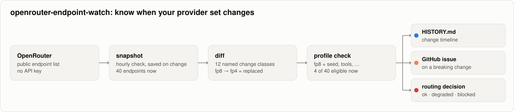
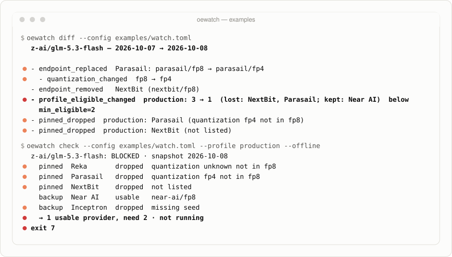
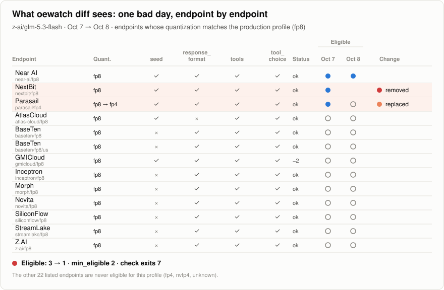
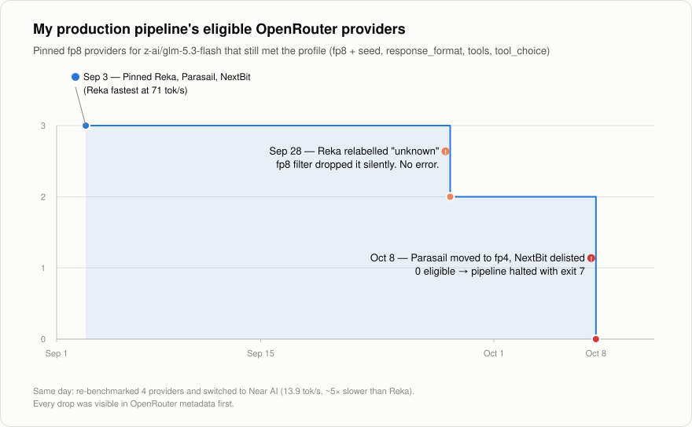

<div align="center">

# openrouter-endpoint-watch

**Your LLM provider changed under you. Find out before your pipeline does.**

Hourly checks, change-only snapshots, and routing decisions for OpenRouter
endpoint metadata: quantization flips, vanished providers, and dropped parameters.

[](https://github.com/hjongc/openrouter-endpoint-watch/actions/workflows/watch.yml)


[](LICENSE)

[Quickstart](#quickstart) · [How it works](#how-it-works) · [Why I built this](#why-i-built-this) · [Live history](HISTORY.md)

</div>

<picture>
  <source media="(prefers-color-scheme: dark)" srcset="docs/assets/architecture-dark.svg">
  
</picture>

openrouter-endpoint-watch (command: `oewatch`) watches the public endpoint list of the OpenRouter models you depend on.
Every hour it checks; when something changes, it saves a snapshot and tells you,
by name, what changed: an fp8 endpoint that became fp4, a provider that
disappeared, a parameter that stopped being supported. Before a run, it tells your pipeline which endpoints to use right now: all of
your pinned providers, the ones still standing, a backup you approved in
advance, or none, in which case it stops before you spend a single token.

<picture>
  <source media="(prefers-color-scheme: dark)" srcset="docs/assets/demo-dark.svg">
  
</picture>

## What diff sees

<picture>
  <source media="(prefers-color-scheme: dark)" srcset="docs/assets/board-dark.svg">
  
</picture>

One bad day, endpoint by endpoint. A model can look abundantly served, with 33
endpoints listed, yet most fp8 endpoints were never usable for this profile
because they lack `seed` or `response_format`. The three that were usable
became one overnight: Parasail's fp8 endpoint was replaced by an fp4 one, and
NextBit disappeared. oewatch reports both as named changes and flags the
profile as below its minimum.

## Live in this repo

This repository runs oewatch on itself. Every hour it checks
`z-ai/glm-5.3-flash`; when anything changes, it saves a snapshot, updates the
counts in the diagram at the top, and appends the change to
[`HISTORY.md`](HISTORY.md). Because snapshots are saved only on change, the
files in [`snapshots/`](snapshots/) form a timestamped log of change events. The margin really is that
thin and that mobile: on the day the repository went public (2026-10-15), the
number of endpoints that could serve the profile went from **5 to 3 of 33
within a few hours**, then back to 5 overnight. Each recovery arrived as a
GitHub issue opened by the workflow ([#1](https://github.com/hjongc/openrouter-endpoint-watch/issues/1),
[#2](https://github.com/hjongc/openrouter-endpoint-watch/issues/2)).

## How it works

**Snapshot.** Each check normalizes the stable fields of every endpoint
(provider, tag, quantization, status, supported parameters, pricing, context)
and drops per-minute noise such as latency and throughput. The result is saved
as `snapshots/<model>/<UTC timestamp>.json` only when it differs from the last
saved snapshot, so a quiet day costs nothing and a change is pinned to the hour. Endpoints are
identified by their OpenRouter tag, because one provider can list the same
model more than once.

**Diff.** Consecutive snapshots are compared and every difference gets a name:

| Change class | What happened | Opens an issue in the scheduled workflow |
|---|---|:---:|
| `endpoint_replaced` | A provider's endpoint left and a new one arrived in its place, typically a quantization flip (`parasail/fp8` → `parasail/fp4`) | ● |
| `quantization_changed` | The quantization of an endpoint changed | ● |
| `endpoint_removed` | An endpoint is no longer listed | ● |
| `profile_eligible_changed` | The set of endpoints that meet a profile changed; flagged when it falls below `min_eligible` | ● |
| `pinned_dropped` | A provider you pinned is no longer usable, with the reason (`quantization unknown not in fp8`, `not listed`, `missing seed`, …) | ● |
| `pinned_restored` | A pinned provider became usable again | |
| `endpoint_added` | A new endpoint is listed | |
| `status_changed` | An endpoint turned healthy or unhealthy | |
| `parameter_added` / `parameter_removed` | Support for a parameter such as `seed` or `tools` changed | |
| `price_changed` | Prompt or completion price changed | |
| `context_changed` | Context length or max completion tokens changed | |

OpenRouter tags embed the quantization, so a flip looks like one endpoint
leaving and another arriving. oewatch pairs them back into a single
`endpoint_replaced` so you read one change, not two.

**Routing decision.** A profile encodes what your pipeline needs. An endpoint
is eligible only if its quantization is listed, every required parameter is
supported, and its status is healthy; `unknown` never matches unless you list
it. If you pin providers, `oewatch check` turns that into one of three
decisions instead of a blunt pass or fail:

| Decision | When | What your run gets | Exit code |
|---|---|---|:---:|
| **ok** | Every pinned provider is usable | The pinned providers, in your order | 0 |
| **degraded** | Some pinned providers dropped, but at least `min_eligible` remain, possibly with backups you approved | The providers still standing, plus a warning that names what dropped and why | 0 (3 with `--strict`) |
| **blocked** | Fewer than `min_eligible` usable even with backups | Nothing: stop before spending tokens | 7 |

The decision lists exact endpoint slugs such as `parasail/fp8`, not just
`parasail`. That matters: in OpenRouter's `provider.order`, a bare provider
slug matches every endpoint of that provider, including its fp4 one.

## Quickstart

```bash
git clone https://github.com/hjongc/openrouter-endpoint-watch
cd openrouter-endpoint-watch
python -m pip install .

# Replay the Oct 8 incident from bundled snapshots (no network):
oewatch diff  --config examples/watch.toml
oewatch check --config examples/watch.toml --profile production --offline; echo $?   # 7

# Your own models, live:
oewatch snapshot
oewatch check --profile production
```

Python 3.11+, standard library only, no API key: the endpoint metadata is
public.

## Use it before every run

In Python, ask for a decision and pass it straight to OpenRouter's provider
routing. A metadata check takes about 0.3 seconds and the result is cached for
five minutes, so it is cheap enough to sit in front of every request:

```python
import oewatch
from openai import OpenAI

decision = oewatch.check("z-ai/glm-5.3-flash", profile="production")
if decision.status == "blocked":
    raise SystemExit(f"not running: {decision.dropped}")
if decision.status == "degraded":
    print("warning:", decision.dropped)          # e.g. Reka: quantization unknown not in fp8

client = OpenAI(base_url="https://openrouter.ai/api/v1", api_key="...")
response = client.chat.completions.create(
    model="z-ai/glm-5.3-flash",
    messages=[{"role": "user", "content": "..."}],
    seed=42,
    extra_body={"provider": decision.provider_preferences()},
    # {"order": ["parasail/fp8", "nextbit/fp8"], "allow_fallbacks": false,
    #  "require_parameters": true, "quantizations": ["fp8"]}
)
```

From the shell, a degraded decision prints a warning and still exits 0, so a
script continues on the providers that are left; only a blocked decision stops
it. Use `--format json` to feed the decision to another tool, `--strict` to
treat degraded as a failure, and `--record runs.jsonl` to keep, next to your
results, which providers each run actually used:

```bash
oewatch check --profile production --record runs.jsonl || exit 1
python run_my_batch.py
```

No profile in a config file? The ad-hoc form works too:

```bash
oewatch check --model z-ai/glm-5.3-flash --quant fp8 \
  --require seed,response_format,tools,tool_choice \
  --pinned "Near AI,Inceptron" --min 1
```

## Configuration

`watch.toml`:

```toml
[watch]
models = ["z-ai/glm-5.3-flash"]   # any OpenRouter model ids
snapshot_dir = "snapshots"

[profiles.production]
quantizations = ["fp8"]
required_parameters = ["seed", "response_format", "tools", "tool_choice"]
pinned = ["Reka", "Parasail", "NextBit"]   # the providers you benchmarked, in order
backup = ["Near AI", "Inceptron"]          # approved substitutes, used only if needed
min_eligible = 2                           # usable providers needed to run
healthy_only = true                        # default
```

Providers can be named by display name (`Near AI`), base slug (`near-ai`), or
exact endpoint slug (`near-ai/fp8`). Without `pinned`, `min_eligible` counts
eligible endpoints instead and the decision is simply ok or blocked. Profiles
are evaluated per model; add as many as your pipelines need.

## Commands and exit codes

| Command | What it does | Exit codes |
|---|---|---|
| `oewatch snapshot [--always] [--at T]` | Fetch every configured model; write `snapshots/<model>/<UTC timestamp>.json` only if something changed | 0 ok, 1 if any model failed |
| `oewatch diff [--from S --to S] [--format md\|json] [--fail-on CLASSES]` | Compare the two latest snapshots, or two given ones (a timestamp, or a date for that day's last snapshot) | 0 ok, **2** when a `--fail-on` class appears, 1 on error or no snapshots |
| `oewatch check --profile NAME [--offline] [--format json] [--strict] [--record FILE]` | Decide which pinned or backup providers to use, on live metadata or the latest snapshot | 0 ok or degraded, 3 degraded with `--strict`, **7** blocked, 1 on error |
| `oewatch history [--out FILE]` | Markdown history per model: tracking period and every recorded change, newest first | 0 ok, 1 on error |

All commands take `--config` (default `watch.toml`) and most take `--model ID`.
A model with only one snapshot is not an error: `diff` says there is nothing to
compare yet and exits 0, so a fresh scheduled job does not fail on its first run.

## Run it on a schedule for your own models

This repository watches itself with
[`.github/workflows/watch.yml`](.github/workflows/watch.yml): every hour (at
minute 17) it checks every configured model. Only when something changed does
it save a snapshot, refresh [`HISTORY.md`](HISTORY.md) and the figures, commit,
and open an issue for the marked change classes above. A quiet hour leaves a
one-line note in the run summary and nothing in the repository.

**Changing how often it checks.** The interval lives in one line of
`watch.yml`, because GitHub reads schedules from the workflow file:

```yaml
on:
  schedule:
    - cron: "17 * * * *"      # hourly; "*/15 * * * *" for every 15 minutes
```

GitHub runs schedules at most every 5 minutes and may delay runs near the top
of the hour. Outside GitHub, any scheduler works, for example a crontab line:
`*/15 * * * * cd /path/to/repo && oewatch snapshot`.

To watch your own models, fork the repository, edit `watch.toml`, and enable
Actions. The workflow only needs the default `GITHUB_TOKEN` with contents and
issues write permission. The figures are rendered by
[`scripts/render_figures.py`](scripts/render_figures.py) with the standard
library only.

## Why I built this

My company runs an LLM on its own servers inside a closed network. Developing
in there is slow, so I built my pipeline outside first and tested it outside
before moving it in. For those outside tests to say anything about the inside,
the model had to be served the way it is served internally: **the same model,
the same fp8 quantization**, plus the parameters the pipeline depends on,
**`seed`, `response_format`, `tools` and `tool_choice`.** OpenRouter was where
I could get that.

Matching the model and quantization was not enough. Even among fp8 providers,
stability and speed differed from one host to the next, so on 2026-09-03 I
benchmarked the ones that qualified and pinned three: Reka, Parasail and
NextBit. Fallbacks off, so a run could never drift to a different setup.

What I did not expect was the serving conditions themselves to change. They
changed twice, and neither time did anything raise an error.

<picture>
  <source media="(prefers-color-scheme: dark)" srcset="docs/assets/incident-dark.svg">
  
</picture>

- **Sep 28.** OpenRouter's metadata started listing Reka's quantization as
  `unknown`. My fp8 filter did exactly what it was told and dropped it. The
  fastest provider (71 tok/s) disappeared from every run, and the only trace was
  a call log that read *Parasail 230, NextBit 15, Reka 0*.
- **Oct 8.** Parasail switched the model to fp4 only and NextBit vanished from
  the list. My pre-run gate stopped with `exit 7: endpoint check left no
  eligible providers`, and every run, from quick tests to full evaluations,
  was blocked. That day I re-benchmarked the four providers that still
  qualified and moved to the best one that answered, about **5× slower**
  (13.9 tok/s) than what I started with.

No provider lied. **The set of endpoints that met my requirements changed
without notice, and I learned it at run time.** Every one of those changes was
already visible in OpenRouter's public `/endpoints` metadata, but that metadata
has no history and no change feed. openrouter-endpoint-watch is that history and that feed.

## FAQ

**OpenRouter already has a quantization filter. Why is that not enough?**
The filter is what dropped my fastest provider without a word. A filter decides
per request; it cannot tell you that the set it filters from changed yesterday.

**Why not turn OpenRouter's fallbacks on?** Then a run can silently switch to
a provider with different weights or parameter support halfway through. oewatch
gives you a controlled version instead: substitutes you approved in advance,
chosen before the run starts, and recorded with `--record`.

**Why poll instead of listening for a webhook?** OpenRouter publishes no
webhook or change feed for endpoint metadata, and the endpoints API sends no
ETag to ask "has this changed?". So oewatch polls a cheap, keyless metadata
request and turns it into events itself: it records and alerts only when
something actually changed.

**Which models can I watch?** Any OpenRouter model id. List as many as you like
in `watch.toml`; profiles are evaluated per model.

**Does it measure quality or speed?** Not yet. v0.1 tracks what providers
declare. A measured layer (does the declared fp8 behave like fp8, how fast is
it under real load) is the next step on the roadmap.

## Roadmap

- Eligibility trend chart: the number of eligible endpoints per profile over
  time, drawn from the change snapshots.
- v0.2: measured probes alongside metadata (latency, tok/s, and an output
  consistency check per endpoint).
- Slack and webhook alerts in addition to GitHub issues.
- Providers beyond OpenRouter.

## License

[MIT](LICENSE)
